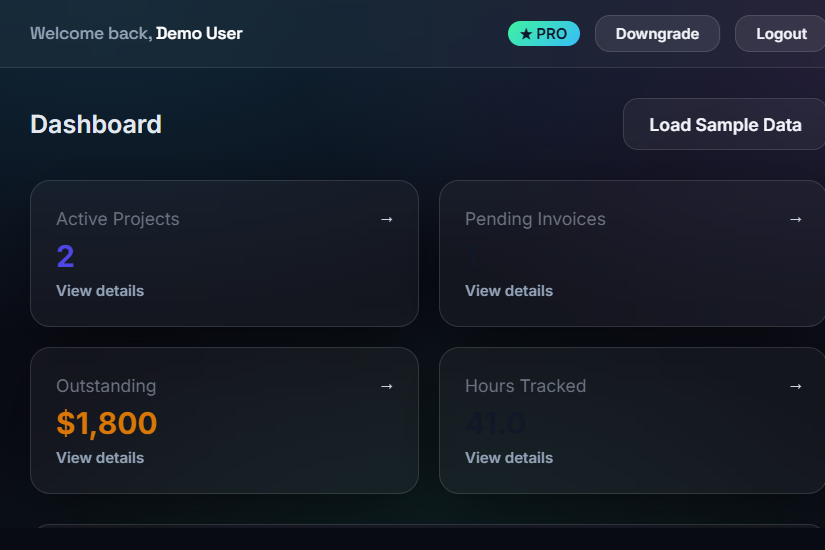
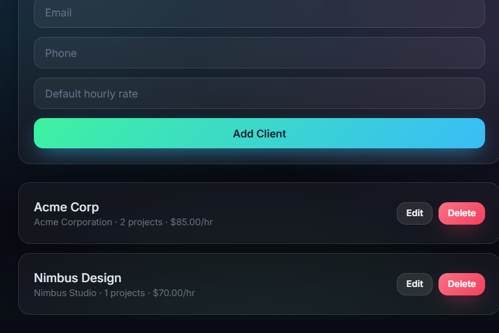
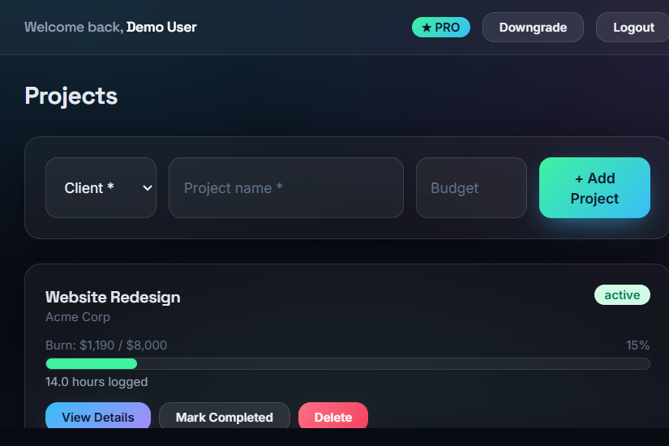
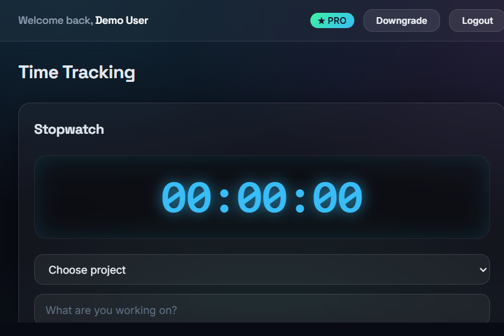
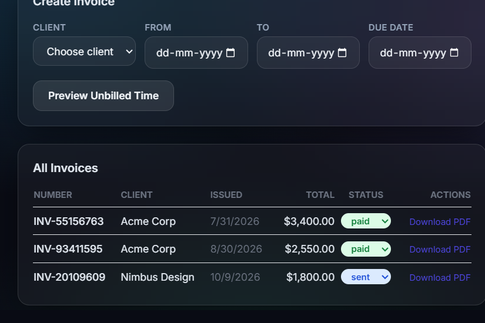
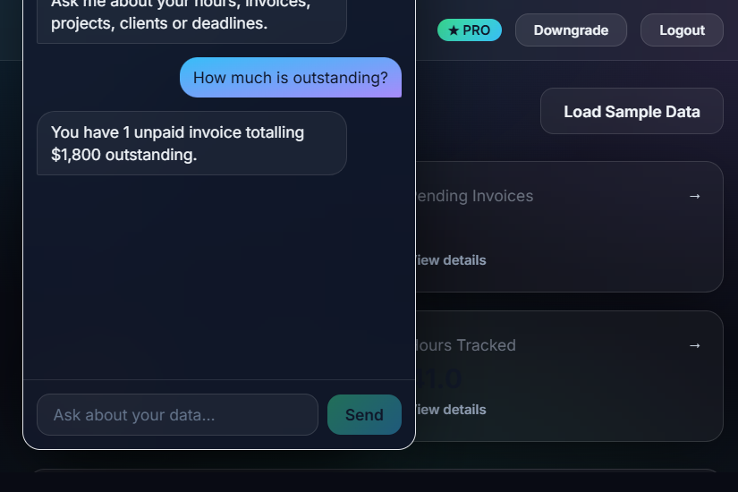

# FreelanceFlow

A B2B SaaS dashboard that consolidates a freelancer's admin work — clients, projects,
time tracking, and professional PDF invoicing — into a single app.

Built with **Node.js + Express + PostgreSQL** (backend) and **React + Vite + Tailwind CSS**
(frontend), with **Recharts** for the financial dashboard and **PDFKit** for invoice generation.

## Screenshots

| Dashboard | Clients |
| --- | --- |
|  |  |

| Projects & burn-rate | Time Tracking |
| --- | --- |
|  |  |

| Invoicing | FlowBot assistant |
| --- | --- |
|  |  |

## Features

| Phase | Feature |
| --- | --- |
| 1 — CRM | JWT auth, Clients / Projects / Tasks CRUD, strict per-user data isolation |
| 2 — Time Tracking | Persistent stopwatch, manual hour entry, per-project burn-rate |
| 3 — Financials | Invoice wizard (client + date range → unbilled logs → total), PDF download, revenue chart |
| 4 — Security & Tiers | Multi-tenancy on every query, Free (max 2 clients) vs Pro (unlimited + PDF) |
| Extra | **FlowBot** — an in-app AI assistant that answers questions grounded in your own data (no external API) |

## Project Structure

```
freelanceflow/
├── backend/           # Express REST API
│   └── src/
│       ├── server.js        # App entry, route mounting
│       ├── db.js            # PostgreSQL pool
│       ├── schema.sql       # Database schema
│       ├── migrate.js       # Creates DB + applies schema
│       ├── seed.js          # Sample data (CLI + "Load Sample Data" endpoint)
│       ├── middleware/auth.js   # JWT auth + Pro gate
│       ├── routes/          # auth, clients, projects, tasks, timelogs, invoices, dashboard, assistant
│       └── utils/pdf.js     # Invoice PDF template
└── frontend/          # React SPA
    └── src/
        ├── context/         # AuthContext, TimerContext (persistent timer)
        ├── components/      # Layout, ProtectedRoute, ChatAssistant (FlowBot)
        └── pages/           # Dashboard, Clients, Projects, TimeTracking, Invoices, Insights
```

## Getting Started

### Prerequisites
- Node.js 18+, PostgreSQL 14+

### 1. Backend

```bash
cd backend
npm install
cp .env.example .env        # then set PGPASSWORD etc. to match your PostgreSQL
npm run migrate             # creates the "freelanceflow" database + tables
npm run seed                # optional: creates demo@freelanceflow.app / demo1234 (Pro)
npm start                   # API on http://localhost:4000
```

### 2. Frontend

```bash
cd frontend
npm install
npm run dev                 # app on http://localhost:5173
```

Open http://localhost:5173 and sign in with the demo account, or register a new one.
Click **Load Sample Data** on the dashboard to populate charts instantly.

## Logic Explanation

### Timer state (persistence)
The authoritative `start_time` lives on the server (an open `time_logs` row with a null
`end_time`). The React `TimerContext` also mirrors the start time to `localStorage`, so on a
page refresh the elapsed counter is recomputed from the stored timestamp and re-synced with the
server via `GET /api/timelogs/running`. This keeps the timer accurate across navigation and
refreshes without drift.

### Multi-tenancy
Every table carries a `user_id`. Each query is scoped with `WHERE user_id = $1` using the id
decoded from the JWT (`req.user.id`), so User A can never read or mutate User B's data.

### Invoicing without double-billing
Creating an invoice runs in a transaction: it inserts the invoice + line items, then sets
`billed = true` and `invoice_id` on the included time logs. Billed logs are excluded from future
previews, so the same hours can never be invoiced twice.

### Freemium limits
The Free plan is capped at 2 clients (enforced server-side on create) and cannot download PDF
invoices (the `/invoices/:id/pdf` route is guarded by `requirePro`). Upgrading flips the user's
`plan` to `pro` and re-issues the JWT.

### FlowBot assistant (no external AI)
The `/api/assistant` route maps a user's question to an intent (outstanding, hours, projects,
invoices, clients, deadlines, burn rate, plan) and answers from live SQL — always scoped by
`req.user.id`. There is no third-party AI call, so it needs no API key, costs nothing, and can
never leak one tenant's data to another. The frontend `ChatAssistant` widget is mounted in the
Layout, so it floats on every authenticated page.

## API Overview

```
POST   /api/auth/register | /login | /plan      GET /api/auth/me
GET/POST/PUT/DELETE  /api/clients
GET/POST/PUT/DELETE  /api/projects
GET/POST/PUT/DELETE  /api/tasks
GET /api/timelogs   POST /api/timelogs/start | /stop | /manual   GET /api/timelogs/running
GET /api/invoices/preview   POST /api/invoices   GET /api/invoices/:id/pdf
GET /api/dashboard/summary | /revenue
POST /api/assistant # FlowBot — natural-language questions over your own data
POST /api/seed      # Load Sample Data
```
